# Study maps and wording

Generated by `tools/build_maps.py` from `tools/study_spec.py`. Do not edit by hand.

Everything the app says on each map, in study order. The announcement plays when a map opens
and again with a double tap. A two-finger double tap plays the information items in order, and a
two-finger swipe down or up reads the next or the previous item on its own. After a short pause
each item is followed by its place among the items played, for example "2 of 6".
In Trial 2 the researcher can switch each item off; the announcement always plays.

## Points for the team to confirm

- The requirements list seven optional items, including Intersection features (medians, bike lanes, islands). The 10/28 descriptions give text for six, so the app has six switches; the median at Fore and Silver is described in items 1 and 5.
- In Trial 2 the count after each item covers only the items switched on, for example "1 of 5" with one item off.
- Pearl Street: the Fore Street leg toward Silver Street is split by the tip of the Boothby Square island, crossed on paving stones. The practice map shows it as a median; the description calls the intersection plus-shaped.
- Gorham's Corner: aerial photos from 2025 show five zebra crosswalks, including the two across Pleasant Street and York Street added in 2023. The maps draw all five. The 2023 changes also set the signals to flash red as a five-way stop; the descriptions say signal controlled.
- Gorham's Corner: city records name the first stretch of the south leg Fore Street; the maps call it York Street, as the descriptions do.
- Commercial Street and Union Street: the leg opposite Union Street is Union Wharf, and the map names it so.
- Route overview: intersection 1 is drawn with Silver Street on both sides, like the other four; the mockup showed no cross street there.
- The crosswalks described as angled are drawn at their measured angles: about 24 degrees at Union and Fore, 26 at Exchange and Moulton, and 28 across Center Street, where York Street meets it at a sharp angle.
- Route overview: the cross street stubs are 13.5 mm, half again as long as before, except the two Fore Street stubs between intersections 2 and 4, which stay 9 mm: those squares are 26.5 mm apart, so longer stubs would meet. The training overview's stubs are 15 mm; to fit them, its Orange Road leg is 22 mm instead of 30.
- Intersections 3 and 4 now sit as near the middle of the screen as their whole walk allows, about 5 and 9 mm off centre. Intersection 1 and reversed 5 are also slightly off centre, about 7 mm, and could be treated the same way.
- Street names start beyond each street's crosswalk. On intersection 2 and reversed 2 all of Fore Street on screen lies between its crossings, so the road itself is not named there; its crosswalks and sidewalks still say Fore Street.
- Route overviews: where the route turns, the intersection's cue ends with "Turn.", for example "Intersection 4: 4-way intersection of Union Street and Fore Street. Turn."
- Intersection maps: the pink dots at the corners, where a crosswalk begins, keep their one ding and now vibrate like the sidewalk, as does the end of a crosswalk between the road and the corner, so a corner has no dead spot. The dots can be left out if the team prefers.
- Intersection maps: the orange turn dots still ding every 0.4 s while touched; they can ding once, like the centre, if the team prefers.

## Training route overview: Home to Nick's Bakery

Training. Map file `training_overview.json`, logged as "Training route overview".

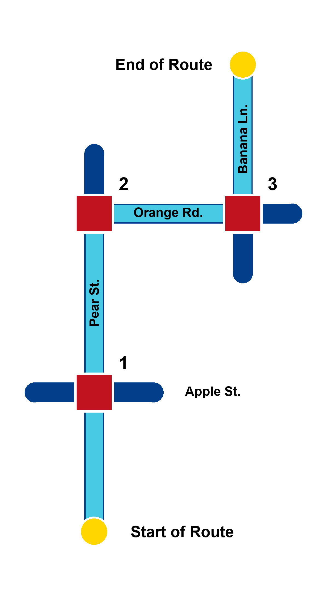

**Overview:** Your route to Nick's Bakery is approximately 0.5 miles away, primarily travelling Northeast. There are 3 intersections along the route, with 2 turns and 4 total street crossings.

What each point says when touched:

- Start dot: "Start of route: You are here, at Home."
- Square 1: "Intersection 1: 4-way intersection of Pear Street and Apple Street." Cross streets drawn: Apple Street.
- Square 2: "Intersection 2: 3-way intersection of Pear Street and Orange Road. Turn." Cross streets drawn: Pear Street.
- Square 3: "Intersection 3: 4-way intersection of Orange Road and Banana Lane. Turn." Cross streets drawn: Banana Lane and Orange Road.
- End dot: "End of route: Your destination, Nick's Bakery."
- Route, by the street it runs along: "Route on Pear Street", "Route on Orange Road", "Route on Banana Lane"

## Training intersection: Pear Street and Apple Street

Training. Map file `training_intersection.json`, logged as "Training intersection".

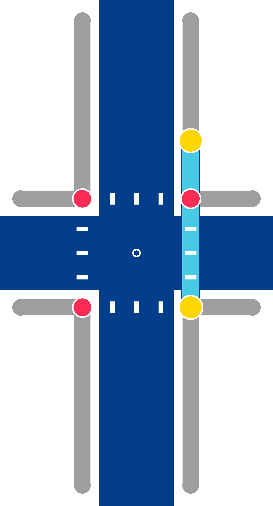

**Announcement:** You are at the 4-way intersection of Pear Street and Apple Street. Your route crosses Apple Street, then continues along Pear Street.

1. *Intersection geometry:* This is a four-way, plus-shaped intersection.
2. *Traffic direction:* Both Pear Street and Apple Street have two-way traffic.
3. *Traffic control:* The intersection is controlled by stop signs in all directions.
4. *Pedestrian signals:* There are no pedestrian signals at this intersection.
5. *Crosswalks:* Your route crossing uses a straight zebra crosswalk.
6. *Truncated domes and curb cuts:* The truncated domes are not aligned with the direction of the crosswalk when crossing Apple Street.

Drawn with north at the top. Legs:

- Pear Street, to the north: zebra crosswalk
- Apple Street, to the east: zebra crosswalk
- Pear Street, to the south: zebra crosswalk
- Apple Street, to the west: zebra crosswalk

The route starts at the corner and crosses: Apple Street.

Turn dots: none.

## Route overview: Dock Fore to Gorham's Corner

Training. Map file `route_overview.json`, logged as "Route overview".

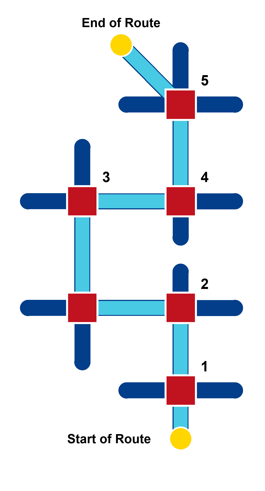

**Overview:** Your route to Gorham's Corner is approximately 0.5 miles away, primarily travelling Southwest. There are 5 intersection crossings along the route.

What each point says when touched:

- Start dot: "Start of route: You are here, at Dock Fore, 336 Fore Street."
- Square 1: "Intersection 1: 4-way intersection of Fore Street and Silver Street." Cross streets drawn: Silver Street.
- Square 2: "Intersection 2: 4-way intersection of Fore Street, Moulton Street, and Exchange Street. Turn." Cross streets drawn: Exchange Street and Fore Street.
- Square at Commercial Street and Moulton Street, no number: "4-way intersection of Commercial Street, Moulton Street, and Long Wharf. Turn." Cross streets drawn: Commercial Street and Long Wharf.
- Square 3: "Intersection 3: 4-way intersection of Commercial Street, Union Street, and Union Wharf. Turn." Cross streets drawn: Commercial Street and Union Wharf.
- Square 4: "Intersection 4: 4-way intersection of Union Street and Fore Street. Turn." Cross streets drawn: Fore Street and Union Street.
- Square 5: "Intersection 5: 5-way intersection of Fore Street, Center Street, York Street, and Pleasant Street. Turn." Cross streets drawn: Center Street and Pleasant Street.
- End dot: "End of route: Your destination, Gorham's Corner."
- Route, by the street it runs along: "Route on Fore Street", "Route on Moulton Street", "Route on Commercial Street", "Route on Union Street", "Route on York Street"

## Intersection 0, practice: Fore Street and Pearl Street

Practice. Map file `intersection_0.json`, logged as "Intersection 0".

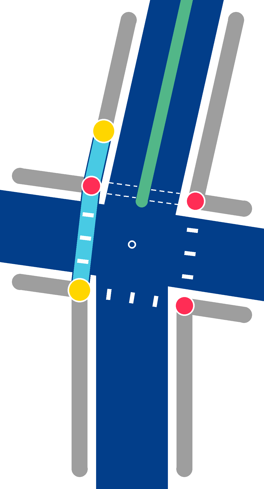

**Announcement:** You are at the 4-way intersection of Fore Street and Pearl Street. Your route crosses Pearl Street, then continues along Fore Street.

1. *Intersection geometry:* This is a four-way, plus-shaped intersection.
2. *Traffic direction:* Both Fore Street and Pearl Street have two-way traffic.
3. *Traffic control:* The intersection is controlled by a traffic signal. Right turns are permitted during the walking cycle.
4. *Pedestrian signals:* The pedestrian signal operates automatically on a timed cycle without a push button.
5. *Crosswalks:* Your route crossing uses a straight zebra crosswalk.
6. *Truncated domes and curb cuts:* There are no curb cuts or truncated domes when crossing Pearl Street.

Drawn with southwest at the top. Legs:

- Fore Street, to the northeast: zebra crosswalk
- Pearl Street, to the southeast: zebra crosswalk
- Fore Street, to the southwest: unmarked crosswalk, median
- Pearl Street, to the northwest: zebra crosswalk

The route starts at the corner and crosses: Pearl Street.

Turn dots: none.

## Intersection 1: Fore Street and Silver Street

Trial 1. Map file `intersection_1.json`, logged as "Intersection 1".

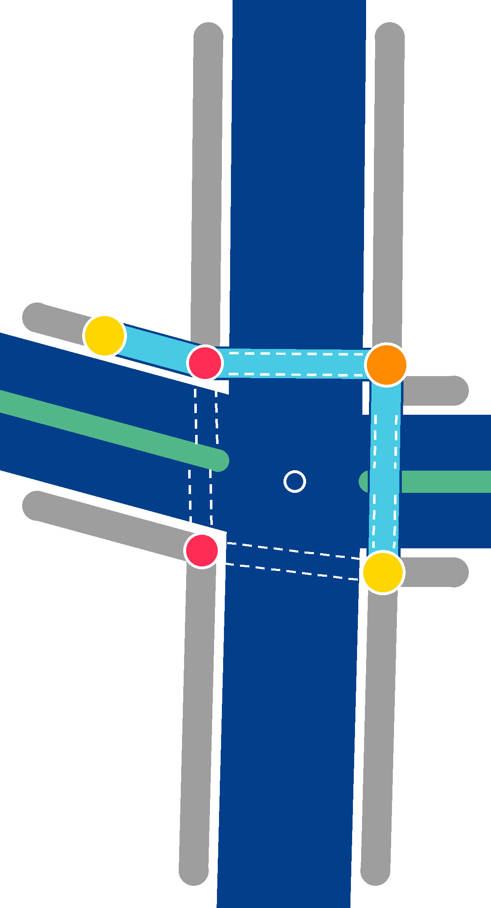

**Announcement:** You are at the 4-way intersection of Fore Street and Silver Street. Your route first crosses Fore Street and then turns left to cross Silver Street, then continues along the other side of Fore Street.

1. *Intersection geometry:* This is a four-way, plus-shaped intersection with a median.
2. *Traffic direction:* Fore Street has two-way traffic, while Silver Street has one-way traffic moving through the intersection.
3. *Traffic control:* Silver Street traffic is controlled by a stop sign.
4. *Pedestrian signals:* There are no pedestrian signals at this intersection.
5. *Crosswalks:* The Fore Street crossing is unmarked and divided into two stages by a median. The Silver Street crossing is unmarked.
6. *Truncated domes and curb cuts:* There are curb cuts with no truncated domes when crossing either street.

Drawn with northwest at the top. Legs:

- Fore Street, to the northeast: unmarked crosswalk, median
- Silver Street, to the southeast: unmarked crosswalk
- Fore Street, to the southwest: unmarked crosswalk, median
- Silver Street, to the northwest: unmarked crosswalk

The route starts at the corner and crosses: Fore Street and Silver Street.

Turn dots: "Turn, left".

## Intersection 2: Fore Street, Moulton Street and Exchange Street

Trial 1. Map file `intersection_2.json`, logged as "Intersection 2".

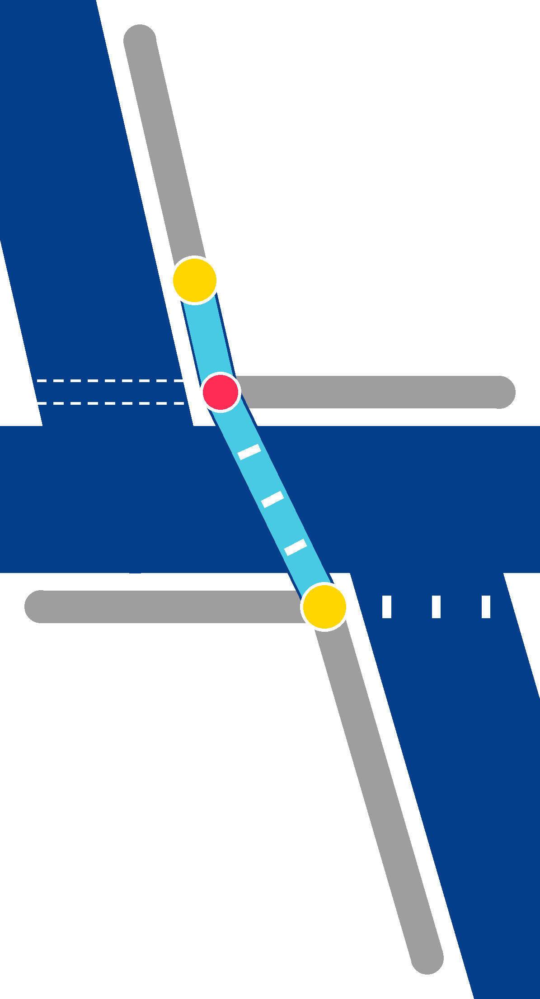

**Announcement:** You are at the 4-way intersection of Fore Street, Moulton Street, and Exchange Street. Your route crosses Fore Street, then continues straight along Moulton Street.

1. *Intersection geometry:* This is a 4-way, offset intersection.
2. *Traffic direction:* Fore Street has two-way traffic. Moulton Street has one-way traffic moving away from the intersection. Exchange Street has one-way traffic moving toward the intersection.
3. *Traffic control:* Exchange Street traffic is controlled by a stop sign.
4. *Pedestrian signals:* There are no pedestrian signals at this intersection.
5. *Crosswalks:* Your crossing uses a zebra crosswalk that angles slightly to the left.
6. *Truncated domes and curb cuts:* The truncated domes are not aligned with the direction of the crosswalk when crossing Fore Street.

Drawn with southeast at the top. Legs:

- Fore Street, to the northeast: no crosswalk drawn
- Exchange Street, to the northwest: zebra crosswalk
- Fore Street, to the southwest: zebra crosswalk
- Moulton Street, to the southeast: zebra crosswalk

The route starts at the corner and crosses: Fore Street, on the angled crosswalk between Exchange Street and Moulton Street.

Turn dots: none.

## Intersection 3: Commercial Street and Union Street

Trial 1. Map file `intersection_3.json`, logged as "Intersection 3".

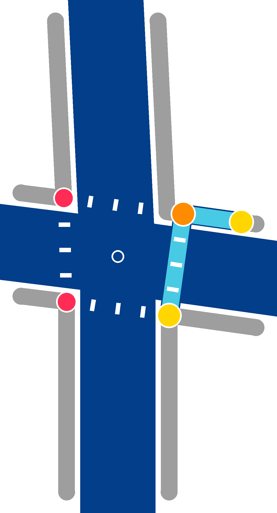

**Announcement:** You are at the 4-way intersection of Commercial Street and Union Street. Your route crosses Union Street, then continues right along Union Street.

1. *Intersection geometry:* This is a four-way, plus-shaped intersection.
2. *Traffic direction:* Both Commercial Street and Union Street have two-way traffic.
3. *Traffic control:* The intersection is controlled by a traffic signal.
4. *Pedestrian signals:* The intersection has APS, located on a pole about 6 feet back from the intersection.
5. *Crosswalks:* Your crossing uses a straight zebra crosswalk.
6. *Truncated domes and curb cuts:* The truncated domes are aligned with the direction of the crosswalk when crossing Union Street.

Drawn with southwest at the top. Legs:

- Commercial Street, to the northeast: zebra crosswalk
- Union Wharf, to the southeast: zebra crosswalk
- Commercial Street, to the southwest: zebra crosswalk
- Union Street, to the northwest: zebra crosswalk

The route starts at the corner and crosses: Union Street.

Turn dots: "Turn, right".

## Intersection 4: Union Street and Fore Street

Trial 1. Map file `intersection_4.json`, logged as "Intersection 4".

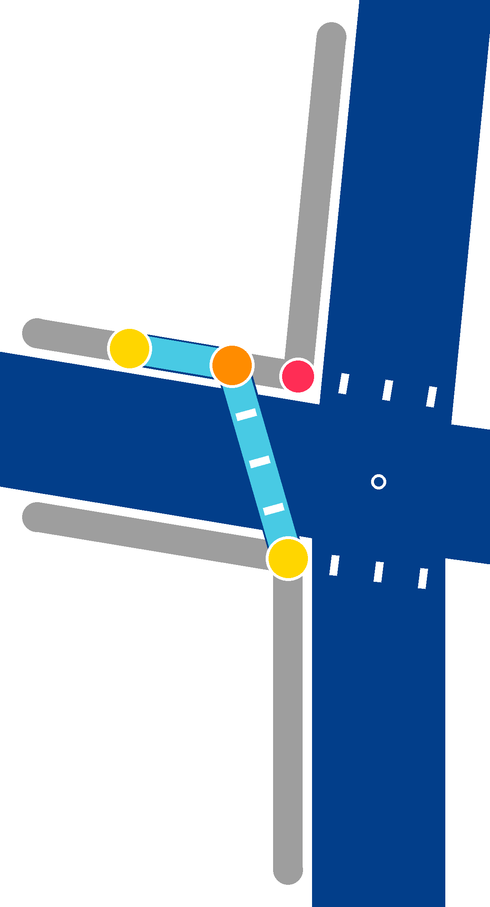

**Announcement:** You are at the 4-way intersection of Union Street and Fore Street. Your route crosses Fore Street, then continues left along the other side of Fore Street.

1. *Intersection geometry:* This is a four-way, plus-shaped intersection.
2. *Traffic direction:* Both Union Street and Fore Street have two-way traffic.
3. *Traffic control:* The intersection is controlled by a traffic signal. It has an exclusive pedestrian crossing phase where all vehicle traffic is stopped.
4. *Pedestrian signals:* The pedestrian signal is activated by a push button, located on a pole at the corner of the intersection.
5. *Crosswalks:* Your crossing uses a zebra crosswalk that angles slightly to the left.
6. *Truncated domes and curb cuts:* The truncated dome is aligned with the crosswalk when approaching the Fore Street crossing. The truncated dome at the end of the crossing is misaligned.

Drawn with northwest at the top. Legs:

- Fore Street, to the northeast: zebra crosswalk
- Union Street, to the southeast: zebra crosswalk
- Fore Street, to the southwest: zebra crosswalk
- Union Street, to the northwest: zebra crosswalk

The route starts at the corner and crosses: Fore Street.

Turn dots: "Turn, left".

## Intersection 5: Fore Street, Center Street and York Street

Trial 1. Map file `intersection_5.json`, logged as "Intersection 5".

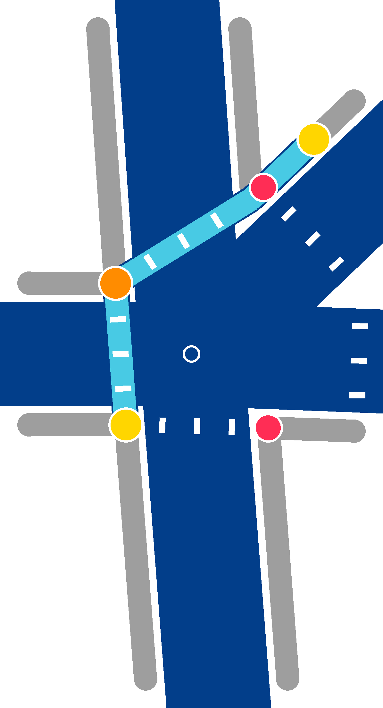

**Announcement:** You are at the 5-way intersection of Fore Street, Center Street, York Street, and Pleasant Street. Your route first crosses Fore Street, then turns right to cross Center Street, and continues along York Street to your destination.

1. *Intersection geometry:* This intersection has 5 legs, with York Street intersecting Fore Street and Center Street at a 45-degree angle.
2. *Traffic direction:* All streets have two-way traffic.
3. *Traffic control:* The intersection is controlled by a traffic signal.
4. *Pedestrian signals:* The pedestrian signals are activated by push buttons, located on poles directly at each street corner.
5. *Crosswalks:* The Fore Street crossing uses a straight zebra crosswalk. The Center Street crossing uses a zebra crosswalk that angles slightly to the left.
6. *Truncated domes and curb cuts:* The truncated domes at both route crossings are not aligned with the direction of the crosswalks.

Drawn with southeast at the top. Legs:

- Fore Street, to the northeast: zebra crosswalk
- Center Street, to the southeast: zebra crosswalk
- York Street, to the south: zebra crosswalk
- Pleasant Street, to the southwest: zebra crosswalk
- Center Street, to the northwest: zebra crosswalk

The route starts at the corner and crosses: Fore Street and Center Street.
Its end says "Destination, Gorham's Corner".

Turn dots: "Turn, right".

## Reversed intersection 5: Center Street, Fore Street and York Street

Trial 2. Map file `return_5.json`, logged as "Reversed intersection 5".

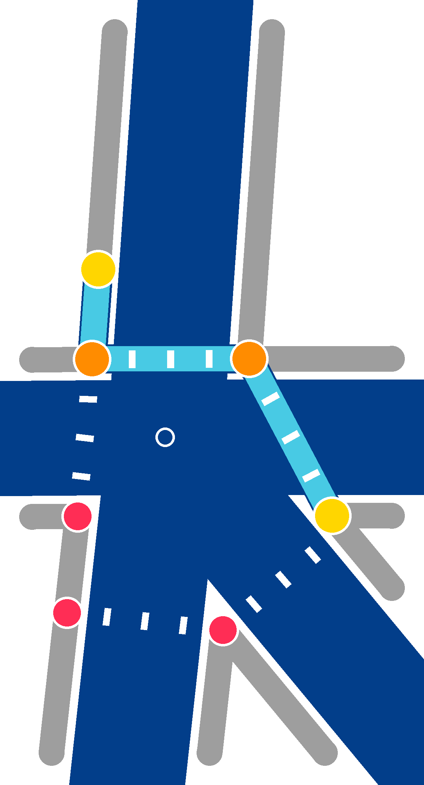

**Announcement:** You are at the 5-way intersection of Center Street, Fore Street, York Street, and Pleasant Street. Your route first crosses Center Street, then turns left to cross Fore Street, and continues along Fore Street.

1. *Intersection geometry:* This intersection has 5 legs, with York Street intersecting Center Street and Fore Street at a 45-degree angle.
2. *Traffic direction:* All streets have two-way traffic.
3. *Traffic control:* The intersection is controlled by a traffic signal.
4. *Pedestrian signals:* The pedestrian signals are activated by push buttons, located on poles directly at each street corner.
5. *Crosswalks:* The Center Street crossing uses a zebra crosswalk that angles slightly to the left. The Fore Street crossing uses a straight zebra crosswalk.
6. *Truncated domes and curb cuts:* The truncated domes at both route crossings are not aligned with the direction of the crosswalks.

Drawn with northeast at the top. Legs:

- Fore Street, to the northeast: zebra crosswalk
- Center Street, to the southeast: zebra crosswalk
- York Street, to the south: zebra crosswalk
- Pleasant Street, to the southwest: zebra crosswalk
- Center Street, to the northwest: zebra crosswalk

The route starts at the corner and crosses: Center Street and Fore Street.

Turn dots: "Turn, left", then "Turn, right".

## Reversed intersection 4: Fore Street and Union Street

Trial 2. Map file `return_4.json`, logged as "Reversed intersection 4".

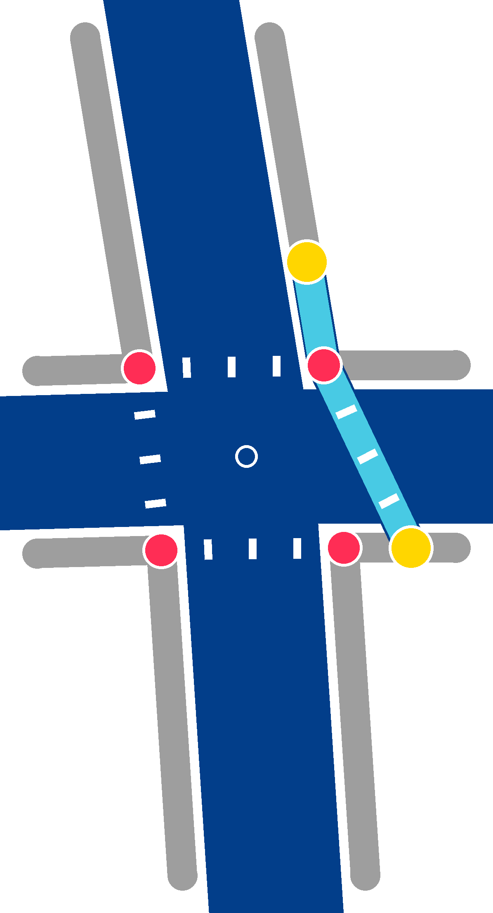

**Announcement:** You are at the 4-way intersection of Fore Street and Union Street. Your route crosses Fore Street, then continues along Union Street.

1. *Intersection geometry:* This is a four-way, plus-shaped intersection.
2. *Traffic direction:* Both Fore Street and Union Street have two-way traffic.
3. *Traffic control:* The intersection is controlled by a traffic signal. It has an exclusive pedestrian crossing phase where all vehicle traffic is stopped.
4. *Pedestrian signals:* The pedestrian signal is activated by a push button, located on a pole at the corner of the intersection.
5. *Crosswalks:* Your crossing uses a zebra crosswalk that angles slightly to the left.
6. *Truncated domes and curb cuts:* The truncated dome is misaligned with the crosswalk when approaching the Fore Street crossing. The truncated dome at the end of the crossing is aligned.

Drawn with southeast at the top. Legs:

- Fore Street, to the northeast: zebra crosswalk
- Union Street, to the southeast: zebra crosswalk
- Fore Street, to the southwest: zebra crosswalk
- Union Street, to the northwest: zebra crosswalk

The route starts at the corner and crosses: Fore Street.

Turn dots: none.

## Reversed intersection 3: Union Street and Commercial Street

Trial 2. Map file `return_3.json`, logged as "Reversed intersection 3".

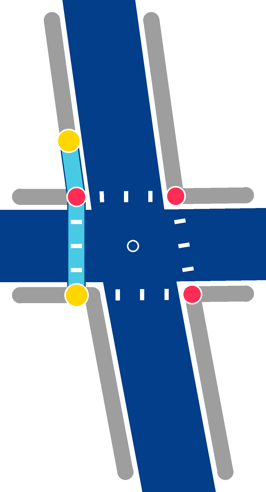

**Announcement:** You are at the 4-way intersection of Union Street and Commercial Street. Your route crosses Union Street, then continues along Commercial Street.

1. *Intersection geometry:* This is a four-way, plus-shaped intersection.
2. *Traffic direction:* Both Union Street and Commercial Street have two-way traffic.
3. *Traffic control:* The intersection is controlled by a traffic signal.
4. *Pedestrian signals:* The intersection has APS, located on a pole about 6 feet back from the intersection.
5. *Crosswalks:* Your crossing uses a straight zebra crosswalk.
6. *Truncated domes and curb cuts:* The truncated domes are aligned with the direction of the crosswalk when crossing Union Street.

Drawn with northeast at the top. Legs:

- Commercial Street, to the northeast: zebra crosswalk
- Union Wharf, to the southeast: zebra crosswalk
- Commercial Street, to the southwest: zebra crosswalk
- Union Street, to the northwest: zebra crosswalk

The route starts at the corner and crosses: Union Street.

Turn dots: none.

## Reversed intersection 2: Moulton Street, Fore Street and Exchange Street

Trial 2. Map file `return_2.json`, logged as "Reversed intersection 2".

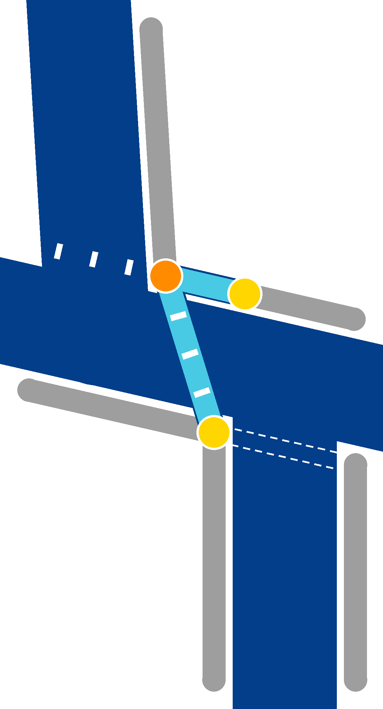

**Announcement:** You are at the 4-way intersection of Moulton Street, Fore Street, and Exchange Street. Your route crosses Fore Street, then continues right along Fore Street.

1. *Intersection geometry:* This is a 4-way, offset intersection.
2. *Traffic direction:* Fore Street has two-way traffic. Moulton Street has one-way traffic moving away from the intersection. Exchange Street has one-way traffic moving toward the intersection.
3. *Traffic control:* Exchange Street traffic is controlled by a stop sign.
4. *Pedestrian signals:* There are no pedestrian signals at this intersection.
5. *Crosswalks:* Your crossing uses a zebra crosswalk that angles slightly to the left.
6. *Truncated domes and curb cuts:* The truncated domes are not aligned with the direction of the crosswalk when crossing Fore Street.

Drawn with northwest at the top. Legs:

- Fore Street, to the northeast: no crosswalk drawn
- Exchange Street, to the northwest: zebra crosswalk
- Fore Street, to the southwest: zebra crosswalk
- Moulton Street, to the southeast: zebra crosswalk

The route starts at the corner and crosses: Fore Street, on the angled crosswalk between Exchange Street and Moulton Street.

Turn dots: "Turn, right".

## Reversed intersection 1: Fore Street and Silver Street

Trial 2. Map file `return_1.json`, logged as "Reversed intersection 1".

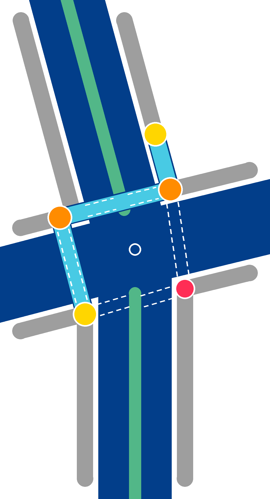

**Announcement:** You are at the 4-way intersection of Fore Street and Silver Street. Your route first crosses Silver Street and then turns right to cross Fore Street.

1. *Intersection geometry:* This is a four-way, plus-shaped intersection with a median.
2. *Traffic direction:* Fore Street has two-way traffic, while Silver Street has one-way traffic moving through the intersection.
3. *Traffic control:* Silver Street traffic is controlled by a stop sign.
4. *Pedestrian signals:* There are no pedestrian signals at this intersection.
5. *Crosswalks:* The Silver Street crossing is unmarked. The Fore Street crossing is unmarked and divided into two stages by a median.
6. *Truncated domes and curb cuts:* There are curb cuts with no truncated domes when crossing either street.

Drawn with northeast at the top. Legs:

- Fore Street, to the northeast: unmarked crosswalk, median
- Silver Street, to the southeast: unmarked crosswalk
- Fore Street, to the southwest: unmarked crosswalk, median
- Silver Street, to the northwest: unmarked crosswalk

The route starts at the corner and crosses: Silver Street and Fore Street.

Turn dots: "Turn, right", then "Turn, left".
